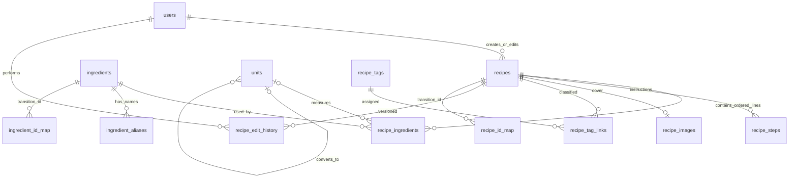

# Unified MySQL schema — design and TEST_ONLY rehearsal

## Design boundary

This is a target design and an isolated conversion rehearsal. It does **not** change the production database or switch the running application. The complete DDL is [unified_schema.sql](../source/database/unified_schema.sql); the repeatable, read-source/write-target converter is [unified_catalog_migration.py](../source/database/unified_catalog_migration.py).

## Tables and decisions

| Table | Purpose and key decisions |
|---|---|
| `users` | USER/ADMIN identity, existing password hash, lock state, timestamps. Unique normalized username. User IDs remain stable. Admin's current environment-based login must be imported as an ADMIN row during a future cutover; keep the signing secret and token claims compatible if existing sessions must survive. |
| `recipes` | One effective recipe per public ID. Stores description, role, total minutes, optional known prep/cook minutes, servings, old instruction fallback, old image URL, visibility, soft-delete time and optimistic `edit_version`. Legacy total minutes are copied unchanged; prep/cook remain `NULL` unless source data actually separates them. |
| `ingredients` | One selected business identity per ID, active state and optional group. There is intentionally no unique normalized-name constraint: source identities with equal or similar labels must not be silently merged. |
| `ingredient_aliases` | Search/display synonyms attached to an ingredient. Aliases are not identities and are not used to merge records. |
| `units` | Unit code, dimension and optional conversion to a base unit. No conversion is inferred where a rule is missing. |
| `recipe_ingredients` | Ordered recipe lines. Primary key `(recipe_id,line_no)` allows the same ingredient on multiple lines, e.g. separate marinade and finishing use. Keeps original quantity text and optional numeric/range/unit fields together. |
| `recipe_steps` | Ordered instructions with optional duration and heat. Original unstructured instructions remain in `recipes.instructions_legacy` as a lossless fallback. |
| `recipe_tags`, `recipe_tag_links` | Many-to-many diet, region, season and occasion tags; migration only copies classifications present in the current effective projection. |
| `recipe_images` | One cover per recipe: safe storage key, media type, dimensions, byte count and SHA-256. Existing fallback URLs remain in `recipes.fallback_image_url`. Image bytes are copied to an isolated root and verified against metadata. |
| `recipe_edit_history` | Optional future snapshots keyed by recipe/version and actor. The current source has current overlays/revisions but no complete append-only edit history to backfill. |
| `recipe_id_map`, `ingredient_id_map` | Cutover-only audit maps from source storage IDs to target business IDs. Recipe source kinds distinguish a v2-to-legacy identity link (`v2_link`) from a v2 catalog projection (`v2_catalog`); this permits both relationships to be audited without claiming they are one target identity. Runtime APIs use the preserved public ID directly and must not join these maps. |
| `unified_import_runs` | Source fingerprint and conversion report. Same source fingerprint/version is a no-op; nonempty target without its marker is rejected. |

The recipe role enum retains `main`, `vegetable`, `soup`, `side`, `drink`, `starch`, and `other`. `starch` remains available because the existing 50-recipe classification uses it, even though current three-dish meal-plan slots only consume main/vegetable/soup.

## Existing function to target data

| Existing behavior | Target tables / compatibility |
|---|---|
| User/Admin accounts | `users`; preserve PBKDF2 hashes and IDs. Admin environment credentials are inserted only from an explicitly supplied local configuration, never printed. Existing tokens remain valid only if the existing session secret, token claims, role checks and expiry rules remain compatible. |
| Ingredient picker, aliases and active state | `ingredients`, `ingredient_aliases`; disabled identities stay stored but are filtered from new selections. |
| Search and B0/P1 ranking | `recipes`, `recipe_ingredients`; adapter projects current `id,title,minutes,required_ids,all_ids`. Ranking code itself is unchanged. |
| Recipe detail and preparation | `recipes`, ordered `recipe_ingredients`, `recipe_steps`; original text is retained and not split unless clearly numbered. |
| Meal Plan v1/v2 | `recipes.role`, `recipe_ingredients`, `recipe_tags`; public IDs and effective visibility stay stable. Existing algorithm contracts remain unchanged. |
| Images | `recipe_images` plus stored file bytes; existing URL fallback is retained. No image row is emitted publicly for hidden/deleted recipes. |
| Hide/delete/restore | `recipes.is_public`, `recipes.deleted_at`; hide and soft-delete are distinct. Recipe/ingredient foreign keys use RESTRICT to preserve history. |
| Admin save and optimistic conflict checks | `recipes.edit_version`, `updated_at`, `recipe_edit_history`; one transaction updates recipe and related lines/steps. |

## ID, visibility and data conversion rules

1. The converter reads through the same repository projection used by current User requests, so only effective public v2 recipes are imported as public. Existing unverified drafts/revisions are not promoted. Explicitly hidden/deleted catalog rows can be retained as private rows with `is_public=0` and/or `deleted_at` set.
2. Legacy recipe IDs and already-public v2 IDs are copied as the target primary keys, preserving API IDs. The current v2 public-ID offset remains below JavaScript's exact integer limit (`2^53-1`).
3. Legacy and v2 ingredient source IDs are crosswalked only according to existing explicit legacy links or the current exact normalized-name projection. No fuzzy synonym matching is done. Conflicting names for one projected business ID stop conversion. The crosswalk records the origin but is not a runtime dependency.
4. Every currently public recipe line must resolve to an ingredient ID in the current public User picker; otherwise conversion stops with the recipe and unresolved IDs. No replacement ID is invented.
5. Total minutes are copied. Unknown prep/cook split and servings remain `NULL`. Quantity strings are kept verbatim; numeric values/units are populated only when the current effective source supplies them. Same-ingredient repeated lines get separate `line_no` values.
6. User password hashes are copied byte-for-byte. Existing ADMIN sessions can be preserved only by carrying forward the same `ADMIN_SESSION_SECRET` and keeping the signed token format and authorization checks intact. An ADMIN username/hash currently held only in environment configuration must be supplied explicitly at conversion time; the converter does not read or display secrets itself.
7. Image metadata and bytes are checked before target writes. TEST_ONLY files go under a database-specific runtime folder. Production cutover would need an explicitly configured permanent image root and a separate verified backup/restore plan.

## TEST_ONLY procedure and rollback

The tested path restores the known SQL dump into a separate private MySQL instance, creates another `_test` database from the DDL, then runs `migrate(..., test_only=True)`. It verifies legacy counts and triggers, migration history, public recipe/ingredient ID sets, foreign-key-backed rows, images, rankings, meal-plan compatibility and repeated-run behavior. The source snapshot is read-only.

- A completed identical import returns `NOOP_ALREADY_APPLIED`.
- A populated target with no matching import marker is rejected; do not delete its rows to force a rerun. Create a fresh isolated target instead.
- Database writes are in one target transaction. A failed conversion rolls back rows and removes only image files created by that attempt. Existing destination files are never overwritten.
- To discard a rehearsal, stop its private MySQL instance and remove only the explicitly named TEST_ONLY database/artifact directory. No production rollback is attempted by this script.
- Production cutover is not designed as an in-place destructive migration. Keep the old database read-only as the rollback source, verify all contracts on a restored clone, then schedule an application cutover separately. Do not delete legacy/v2 tables as part of this rehearsal.

## Test separation and remaining cutover work

| Layer | Validation in this rehearsal |
|---|---|
| Data/DDL/import | `tests/test_unified_catalog_migration.py`: private MySQL restore, DDL, baseline counts/checksums, FK rows, ID sets, images, idempotence and partial-target refusal. |
| Target repository | Same test exercises ingredient list, recipe detail, visibility, ranking projection and meal classification from the unified tables. |
| Search/B0/P1/Meal Plan | Target projection is exercised with the existing ranking and Meal Plan functions; regression suites `test_search.py`, `test_search_relevance.py`, `test_ranking.py`, `test_meal_plan.py`, `test_meal_plan_v2.py` also pass. |
| TCP/FastAPI/Admin/User browser | Not run against this schema: no runtime operation is wired to `UnifiedRepository`, by design, so pretending these tests exercised the target would be misleading. Before cutover, wire a TEST_ONLY database configuration and add separate TCP contract, FastAPI auth/CSRF, User/Admin, and Playwright suites. |

The current application is **not** switched to this schema, and live production `information_schema` was not freshly inspected in this session because the configured Codex MySQL credential was unavailable. The verified backup is a snapshot, not proof of the database's present state.
